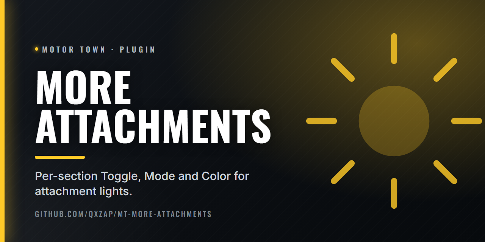

  

# More Attachments

Plugin for More Attachments: per-section light control.

Each labelled light section on an attachment gets its own Toggle, Mode and Color, stored per vehicle and slot.

Settings: `Binaries\Win64\plugins\more_attachments.ini`.

## Install

Needs [Plugin Loader](https://github.com/qxZap/mt-plugin-loader) (`version.dll`) in
`MotorTown\Binaries\Win64\`. Put `mt_plugin_MoreAttachments.dll` in `MotorTown\Binaries\Win64\plugins\`.

## Build

`build.bat` (MSVC 2022, x64) writes `out\mt_plugin_MoreAttachments.dll`.
